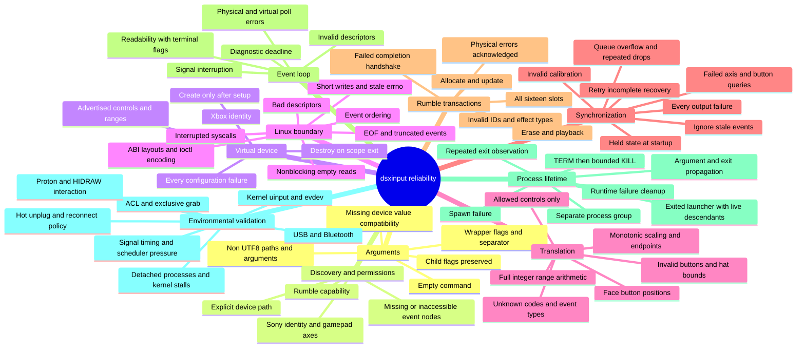

# Reliability map

This map organizes failure modes by boundary. It is a test inventory, not a claim that every possible failure has been proved impossible. Tests do not run `app::run`, open controller nodes, grab input, create a real virtual device, or launch a game. Process tests launch isolated `/bin/sh` and `/bin/sleep` fixtures; event I/O tests use local socket pairs.



## Automated assertions

| Boundary | Assertions and test modules |
| --- | --- |
| CLI | `cli::tests`, `native_argument_tests`: empty input, separator, repeated options, command passthrough, native byte preservation. Missing `--device` value retains prior behavior: it becomes the child command. |
| Controller setup | `device_tests`, `setup_failure_tests`: identity, effect capacity, capability ioctl errors, eight calibrated axes, eleven unique buttons, abort at each of 34 configuration operations, creation last. |
| Linux ABI | `linux_tests`, `layout_tests`: 64-bit event/effect layouts, union alignment, ioctl numbers, zero timestamps, kernel errno preservation. |
| Event transport | `interruption_tests`, `transfer_failure_tests`, `linux_tests`: EINTR retries, no retry after short transfer, EOF/truncation, all short write lengths, stale errno, empty nonblocking input, ordered events. Short transfers fail rather than emitting a second partial event record. |
| Mapping | `mapping_tests`, `axis_overflow_tests`, `event_tests`, `invariant_tests`: positional mapping, per-axis calibration, supported controls, signed and trigger endpoints, integer extremes, 4,097 samples for each of five calibration ranges. Every 16-bit code is exercised for four event types and seven extreme/representative values (1,835,008 combinations). Output is bounded; invalid button values are discarded. |
| State queries | `snapshot_query_tests`: each axis query failure, button query failure, equal/reversed/extreme invalid ranges on all eight axes. |
| State publication | `relay::tests`, `failure_tests`: startup state, repeated queue overflow, stale event suppression, failed recovery queries, failure at every one of twenty output positions during startup and resync, retained recovery mode after partial output, successful retry, ordinary write errors. A partial snapshot cannot be rolled back; the final SYN_REPORT is withheld if an earlier write fails. |
| Rumble | `feedback_tests`, `transaction_tests`: all slots with new/existing effects, negative/out-of-range IDs, unsupported effects, ENOSPC/ENODEV/EIO/EINVAL/EACCES, matching completion handshake, no mapping mutation on physical failure, mapping matches actual device state when completion fails, erase, playback, ignored unrelated input. |
| Poll | `app::tests`: HUP/ERR/NVAL for both devices, with and without simultaneous readability, healthy and idle poll results. Terminal conditions are handled before reads. |
| Process | `process_tests`, `empty_command_tests`, `shutdown_tests`, `observed_exit_tests`: no command, missing executable, arguments and status, own process group, ignored SIGTERM, surviving descendants, already-exited launcher, repeated status observation, bounded cleanup on runtime errors. |

## Changes made after examining failure paths

- Retain ownership of the child's process group after `try_wait` observes launcher exit, so descendants still receive shutdown signals; return cached status on subsequent calls.
- Check terminal poll conditions on both descriptors, including POLLNVAL, before reading.
- Retry interrupted reads, writes and ioctls. Report short writes as WriteZero instead of using unrelated stale errno.
- Discard invalid button values and clamp hat values to the advertised range.
- Use native OS strings throughout argument parsing and launching, avoiding UTF-8 conversion panics for valid Linux filenames or arguments.
- Introduce small injectable boundaries for setup, snapshot queries and rumble transactions so their actual production control flow is tested under failures.

## Validation and limits

Verified on Linux x86_64 without launching the application:

```sh
cargo test --all-targets --locked
cargo test --all-targets --release --locked
cargo fmt --check
cargo clippy --all-targets --locked -- -D warnings
cargo build --release --locked
git diff --check
```

Both test profiles pass 71 tests. The build and strict lint checks pass. No coverage percentage is claimed.

Successful real kernel ioctls, actual resource destruction/ungrabbing, discovery across real device nodes, ACL enforcement, physical rumble, USB/Bluetooth timing, hot unplug during requests, signal delivery during blocked I/O, diagnostic wall-clock behavior, and Wine/Proton/HIDRAW interoperability remain integration checks. Setup and rumble fault injection validates userspace decisions, not kernel behavior. The full event-loop orchestration and signal registration are inspected but not executed by these tests. The ABI assertions target 64-bit Linux; other architectures have not been validated.

Reconnect is intentionally unsupported. Shutdown covers the launched process group and direct child, not descendants that detach into other groups. Uninterruptible kernel waits and scheduler stalls prevent hard real-time guarantees. The tests materially improve confidence within these boundaries; they cannot establish clock-like reliability for every hardware, kernel and launcher combination.
